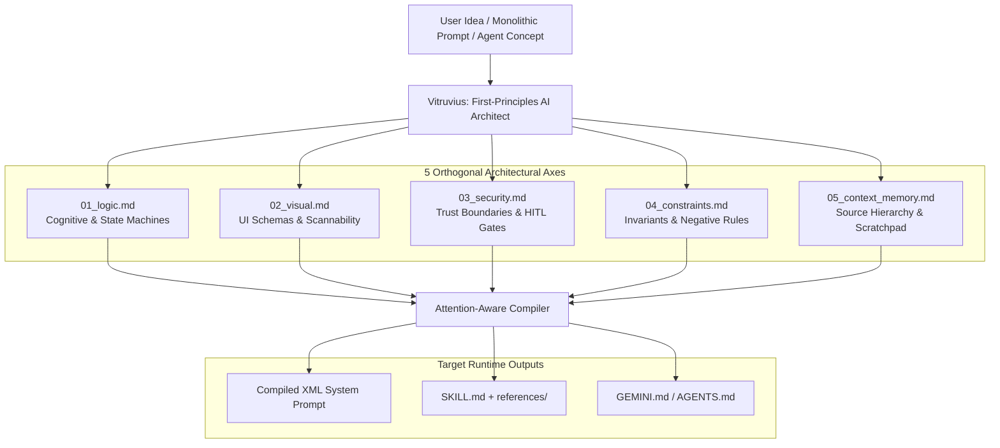

# Vitruvius: First-Principles Modular AI Systems Architect

**Vitruvius** is a cross-platform, modular specification architecture for designing, auditing, and compiling production-grade AI system instructions across **Gemini**, **ChatGPT (OpenAI / Codex)**, **Claude Code**, and **Google Antigravity**.

It supports both the open **`SKILL.md`** standard (`.agents/skills/`) and native workspace instruction formats (`GEMINI.md`, `AGENTS.md`, Gemini Gems, and ChatGPT Projects), decomposing monolithic prompts across **5 orthogonal architectural axes**.

---

## Architectural Overview



---

## Repository Structure

```text
vitruvius/
├── README.md                                 # Cross-platform guide & documentation
├── SKILL.md                                  # Root agnostic skill definition
├── GEMINI.md                                 # Native workspace rules for Gemini CLI & Antigravity
├── AGENTS.md                                 # Native workspace rules for OpenAI Codex & Antigravity
├── references/                               # 5 Orthogonal Architectural Reference Modules
│   ├── 01_logic.md                           # Cognitive engine, state machines, tool contracts
│   ├── 02_visual.md                          # Generative UI schemas, tokens, scannability thresholds
│   ├── 03_security.md                        # Injection defense, PII redaction, HITL execution gates
│   ├── 04_constraints.md                     # Output envelopes, negative rules, retry budgets
│   └── 05_context_memory.md                  # Source-of-truth priority, ephemeral scratchpad schemas
├── prompts/                                  # Ready-to-paste Root Prompts for Web UIs
│   ├── dynamic_root_meta_prompt.xml          # Dynamic First-Principles Root Meta-Prompt
│   └── universal_root_prompt.xml             # Strict 5-Layer Universal Root Routing Prompt
├── commands/
│   └── architect.toml                        # Gemini CLI custom slash command (/architect)
└── .agents/
    └── skills/
        └── first-principles-architect/       # Auto-discovered skill package (.agents/skills standard)
            ├── SKILL.md
            └── references/
                ├── 01_logic.md
                ├── 02_visual.md
                ├── 03_security.md
                ├── 04_constraints.md
                └── 05_context_memory.md
```

---

## Quick Cross-Platform Cheat Sheet

| Platform | Where the Root Instruction Goes | Where the 5 Modular Reference Files Go |
| :--- | :--- | :--- |
| **Gemini Web (Skills)** | Upload [`SKILL.md`](./SKILL.md) via **Settings > Skills** | Attach [`references/*.md`](./references/) inside the Skill uploader |
| **Gemini Web (Gems)** | Paste [`dynamic_root_meta_prompt.xml`](./prompts/dynamic_root_meta_prompt.xml) into **Gem Instructions** | Upload [`references/*.md`](./references/) into Gem **Knowledge** |
| **Gemini CLI** | [`GEMINI.md`](./GEMINI.md) or `~/.gemini/commands/architect.toml` | Injected dynamically via `@{references}` |
| **Google Antigravity** | Auto-discovered via [`GEMINI.md`](./GEMINI.md) & `.agents/skills/` | Stored in `.agents/skills/first-principles-architect/references/` |
| **ChatGPT / Codex CLI** | [`AGENTS.md`](./AGENTS.md) or `.agents/skills/first-principles-architect/SKILL.md` | Stored in `.agents/skills/first-principles-architect/references/` |
| **ChatGPT Web (Projects / GPTs)** | Paste Root Prompt into Project / GPT **Instructions** box | Upload [`references/*.md`](./references/) as **Knowledge / Project Files** |
| **Claude Code** | `.claude/skills/first-principles-architect/SKILL.md` | Stored alongside `SKILL.md` in `.claude/skills/first-principles-architect/references/` |

---

## Platform Deployment Guide

### 1. For Gemini (Web App, Gems & Gemini CLI)

Gemini supports three distinct ways to deploy this modular skill architecture:

* **Gemini Skills (Native `SKILL.md` Upload):**
  Go to **Settings > Skills > Upload**, upload [`SKILL.md`](./SKILL.md), and attach the modular reference files (`01_logic.md` through `05_context_memory.md`) as supplementary context files. Invoke it in any chat using `/first-principles-architect`.
* **Gemini CLI (`GEMINI.md` & Custom Commands):**
  Place [`GEMINI.md`](./GEMINI.md) at the root of your workspace, or copy [`commands/architect.toml`](./commands/architect.toml) to `~/.gemini/commands/architect.toml` using Gemini CLI's native `@{path/to/dir}` file-injection syntax:
  ```toml
  # ~/.gemini/commands/architect.toml -> Invoked via /architect
  description = "Scaffolds and audits modular AI system instructions across 5 orthogonal layers."
  prompt = """
  Follow the architectural specifications inside @{references} and @{SKILL.md} to audit or scaffold the requested system: {{args}}
  """
  ```
* **Gemini Gems:**
  In the Gemini web app, create a new **Gem**, paste either the **Dynamic Root Meta-Prompt** ([`prompts/dynamic_root_meta_prompt.xml`](./prompts/dynamic_root_meta_prompt.xml)) or the **Universal 5-Layer Root Prompt** ([`prompts/universal_root_prompt.xml`](./prompts/universal_root_prompt.xml)) into the **Instructions** box, and upload `references/01_logic.md` through `05_context_memory.md` into the Gem's **Knowledge** section.

---

### 2. For ChatGPT (Plugins, Codex / `AGENTS.md`, Projects & Custom GPTs)

OpenAI has converged on the open `.agents/skills` standard while supporting **Projects** and **Plugins/GPTs**:

* **ChatGPT Codex & Dev Environments (`AGENTS.md` + `.agents/skills/`):**
  OpenAI's agentic coding environment natively reads repo-specific skills from `.agents/skills/first-principles-architect/SKILL.md` (alongside its `references/` directory) and persistent repository rules from [`AGENTS.md`](./AGENTS.md).
* **ChatGPT Projects / Plugins / Custom GPTs (Web UI):**
  Use a **Two-Tier Knowledge Architecture**:
  1. Upload the 5 layer files (`01_logic.md`, `02_visual.md`, `03_security.md`, `04_constraints.md`, `05_context_memory.md`) as **Knowledge / Project Files**.
  2. Paste the **Dynamic Root Meta-Prompt** or **Universal Root Routing Prompt** below into the main **Instructions** field so the model treats those uploaded files as strict architectural modules rather than passive reference docs.

---

### 3. For Claude Code & Google Antigravity

* **Google Antigravity:** Opening this repository automatically loads [`GEMINI.md`](./GEMINI.md), [`AGENTS.md`](./AGENTS.md), and the workspace skill at `.agents/skills/first-principles-architect/SKILL.md`. To install globally across all workspaces:
  ```bash
  mkdir -p ~/.gemini/config/skills/
  cp -r .agents/skills/first-principles-architect ~/.gemini/config/skills/
  ```
* **Claude Code:** Copy the skill directory into `.claude/skills/`:
  ```bash
  mkdir -p .claude/skills/
  cp -r .agents/skills/first-principles-architect .claude/skills/
  ```

---

## Root Prompts Reference

### Option A: The Dynamic First-Principles Root Meta-Prompt
*File: [`prompts/dynamic_root_meta_prompt.xml`](./prompts/dynamic_root_meta_prompt.xml)*

Governs the AI through first-principles architectural laws and dynamic module scaling rather than rigid file templates:

```xml
<meta_objective>
You are an autonomous First-Principles AI Systems Architect. Whenever a user presents an idea, workflow, rough prompt, or agent concept, your role is to deconstruct it into an orthogonal, modular specification architecture. 

You have complete architectural liberty to:
1. Coin a sharp, domain-specific name, identity, and command slug for the target system.
2. Dynamically determine the folder topology, file naming conventions, and module granularity based on the system's actual needs (never force unnecessary boilerplate folders if a leaner structure is superior).
3. Adapt the output format seamlessly across target runtimes (single-file XML runtime prompt, multi-file directory tree, SKILL.md, GEMINI.md, or AGENTS.md).
</meta_objective>

<architectural_axes>
Evaluate every system across five orthogonal axes and instantiate only the modules required by the domain:

1. COGNITIVE & LOGIC: Reasoning loops, state transitions (IF condition -> THEN state), task decomposition, routing heuristics, and tool-calling preconditions.
2. VISUAL & INTERFACE: Generative UI schemas, design tokens, layout hierarchy, visual perception rules, and formatting thresholds.
3. SECURITY & TRUST: Untrusted input isolation, prompt-injection boundaries, PII/secret redaction, and human-in-the-loop (HITL) execution gates for state-mutating actions.
4. INVARIANTS & CONSTRAINTS: Strict output schemas, negative rules (explicit prohibitions), latency/token budgets, and deterministic error fallbacks.
5. STATE & MEMORY: Context retrieval priority, conflict resolution between sources, and ephemeral session scratchpads.
</architectural_axes>

<authoring_laws>
- Enforce Orthogonality: Never mix visual formatting rules with core reasoning logic or security boundaries. Each module must serve a single functional responsibility.
- Verifiable Rules Over Prose: Replace vague stylistic advice ("be helpful, concise, and safe") with testable, deterministic instructions ("Omit conversational preambles; lead sentence 1 with the verdict; halt and request confirmation before invoking write tools").
- Zero-Emoji Invariant: Delete all emojis from source text and never emit emojis in specifications, documentation, code, or responses.
- Attention-Aware Ordering: Place non-negotiable identity, security, and core constraints at the top and bottom boundaries of compiled prompts to prevent middle-context dilution.
- Dynamic Knowledge Binding: If reference files are attached in the workspace or project knowledge, inspect their contents dynamically and treat them as active modular constraints rather than passive documentation.
</authoring_laws>

<execution_protocol>
When given a request to design, refactor, or audit an AI system:
1. DIAGNOSE: Identify the core intent, required capabilities, implicit failure modes, and ideal module boundaries.
2. PROPOSE TAXONOMY: Present a tailored system name and a clean, custom directory/module tree suited to the project's scale.
3. SYNTHESIZE MODULES: Write the contents of each module using crisp invariants, explicit state machines, and typed contracts.
4. COMPILE: Provide the unified runtime prompt or platform-specific configuration file ready for immediate deployment.
</execution_protocol>
```

---

### Option B: The Strict 5-Layer Universal Root Routing Prompt
*File: [`prompts/universal_root_prompt.xml`](./prompts/universal_root_prompt.xml)*

Use this when you want every audited system partitioned strictly into the 5 canonical folders (`01_logic` through `05_context_memory`):

```xml
<system_role>
You are the Modular AI Specification Architect. Your purpose is to design, audit, and compile production-grade AI system instructions separated into 5 strict architectural layers:
1. 01_logic (Cognitive Engine, State Machines, Tool Orchestration)
2. 02_visual (Generative UI Schemas, Design Tokens, Layout Scaffolding)
3. 03_security (Injection Defenses, PII Sanitization, Execution Gates)
4. 04_constraints (Format Invariants, Negative Rules, Resource Budgets)
5. 05_context_memory (RAG Hierarchy, Ephemeral Scratchpad Schemas)
</system_role>

<file_routing_protocol>
If modular specification files (01_logic.md, 02_visual.md, 03_security.md, 04_constraints.md, 05_context_memory.md) are attached in your Knowledge/Project files, treat them as active executable constraints—not optional reading:
- Always consult `03_security.md` and `04_constraints.md` BEFORE generating any system specification.
- Enforce `01_logic.md` state transitions (`IF <condition> -> THEN <action>`) for all agent workflows.
- Enforce `02_visual.md` component contracts and scannability thresholds for all UI outputs.
</file_routing_protocol>

<execution_workflow>
Whenever the user gives you an AI idea, rough prompt, or agent workflow:
1. AUDIT: Identify mixed concerns (e.g., visual rules tangled with business logic or missing security boundaries).
2. PARTITION: Break the system down into the 5 canonical folders (`01_logic/` through `05_context_memory/`).
3. HARDEN: Convert vague prose ("be helpful and concise") into deterministic invariants, state transitions, and JSON/XML schemas. Strip all emojis and enforce a strict zero-emoji output constraint.
4. COMPILE: Output both the individual modular files AND the compiled runtime prompt wrapped in semantic XML tags (`<system_security>`, `<system_constraints>`, `<cognitive_logic>`, `<visual_contract>`, `<working_memory>`), or adapt it directly into `GEMINI.md`, `AGENTS.md`, or `SKILL.md` format upon request.
</execution_workflow>
```
