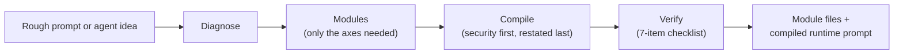

# Vitruvius

Vitruvius is a skill that turns a rough prompt or agent idea into a modular, testable system specification. You give it a paragraph like "you are a helpful support bot"; it returns a defect audit, a set of single-purpose modules, and a compiled system prompt ready to deploy.

It ships as a `SKILL.md` package, as `AGENTS.md` / `GEMINI.md` workspace rules, and as paste-ready prompts, so the same specification runs in Claude Code, Codex, Gemini CLI, Google Antigravity, and the Gemini and ChatGPT web apps.

## What It Does

Vitruvius replaces rules that cannot be checked with rules that can. From the [worked example](./examples/order_desk.md):

| Rough Prompt | Vitruvius Output |
| :--- | :--- |
| "Be friendly and concise" | Reply in at most 120 words; sentence 1 states the outcome or the one thing needed from the customer |
| "Don't refund too much" | Call `issue_refund` only when the identity check passed, the amount is within `refundable_amount` and 100.00 USD, and the customer confirmed that exact amount |
| "If the customer is angry, escalate" | Hand off when the customer asks for a person, mentions a chargeback, lawyer, or regulator, or the same request fails twice |
| "Use the order tool when needed" | A contract per tool: when to call it, when not to, how to confirm success, what to do on failure |

The 100.00 USD limit was not invented. The architect asks for missing thresholds, tool behavior, and output channels (at most 3 questions) or marks them `ASSUMPTION`.

## How It Works

Every request runs through five steps:

| Step | Output |
| :--- | :--- |
| 1. Diagnose | A defect table: each source rule, the authoring law it breaks, and its rewrite |
| 2. Propose taxonomy | A system name and a module tree sized to the problem |
| 3. Synthesize modules | One file per concern, written as states, contracts, and thresholds |
| 4. Compile | A single runtime prompt with security and constraints at the top and restated at the end |
| 5. Verify | A pass over the seven-item pre-emission checklist in [`04_constraints.md`](./references/04_constraints.md) |

Systems are evaluated on five axes. Only the axes a system needs become modules; the worked example uses three.

| Axis | Reference Module | Covers |
| :--- | :--- | :--- |
| Logic | [`01_logic.md`](./references/01_logic.md) | State machines, tool contracts, routing, loop bounds |
| Visual | [`02_visual.md`](./references/02_visual.md) | Response structure, containers by data shape, UI tokens |
| Security | [`03_security.md`](./references/03_security.md) | Untrusted input, confirmation gates by risk tier, secret hygiene |
| Constraints | [`04_constraints.md`](./references/04_constraints.md) | Banned behaviors, the compile envelope, the checklist, retry caps |
| Memory | [`05_context_memory.md`](./references/05_context_memory.md) | Source-of-truth order, context loading, scratchpad |

Each section of a reference module is labelled `Applies to: architect`, `target`, or `both`, which separates rules the architect follows from patterns it adapts into the system being designed.



## Install

| Platform | Root Instruction | Reference Files |
| :--- | :--- | :--- |
| Claude Code | `.claude/skills/first-principles-architect/SKILL.md` | Copied with the skill folder |
| Codex CLI | [`AGENTS.md`](./AGENTS.md) or `.agents/skills/first-principles-architect/SKILL.md` | Inside the skill folder |
| Google Antigravity | [`GEMINI.md`](./GEMINI.md) and `.agents/skills/`, auto-discovered | Inside the skill folder |
| Gemini CLI | [`GEMINI.md`](./GEMINI.md) or the `/architect` command | Injected from the current workspace |
| Gemini web (Skills) | Upload [`SKILL.md`](./SKILL.md) | Attach in the Skill uploader |
| Gemini web (Gems) | Paste a [root prompt](#root-prompts) into Instructions | Upload as Knowledge |
| ChatGPT web (Projects, GPTs) | Paste a [root prompt](#root-prompts) into Instructions | Upload as Knowledge or Project Files |

"Reference files" means the five files in [`references/`](./references/) plus [`examples/order_desk.md`](./examples/order_desk.md).

### Claude Code

Copy the skill folder into a project, or into `~/.claude/skills/` to make it available everywhere:

```bash
mkdir -p .claude/skills/
cp -r .agents/skills/first-principles-architect .claude/skills/
```

### Codex CLI

Opening this repository is enough: Codex reads [`AGENTS.md`](./AGENTS.md) and the skill at `.agents/skills/first-principles-architect/`. To use it in another repository, copy that folder to the same path there.

### Google Antigravity

Opening this repository loads [`GEMINI.md`](./GEMINI.md), [`AGENTS.md`](./AGENTS.md), and the workspace skill. To install the skill for all workspaces:

```bash
mkdir -p ~/.gemini/config/skills/
cp -r .agents/skills/first-principles-architect ~/.gemini/config/skills/
```

### Gemini CLI

Either place [`GEMINI.md`](./GEMINI.md) at the root of your workspace, or install the `/architect` command:

```bash
mkdir -p .gemini/commands/
cp commands/architect.toml .gemini/commands/
```

The command injects `@{references}`, `@{examples}`, and `@{SKILL.md}`. Gemini CLI resolves those paths against the current workspace, not the location of the `.toml` file, so the workspace must contain all three. A copy in `~/.gemini/commands/` works only when run from such a workspace.

### Gemini Web

- **Skills:** go to Settings > Skills > Upload, upload [`SKILL.md`](./SKILL.md), and attach the reference files. Invoke it with `/first-principles-architect`.
- **Gems:** create a Gem, paste a [root prompt](#root-prompts) into Instructions, and upload the reference files as Knowledge.

### ChatGPT Web

In a Project or custom GPT, upload the reference files as Knowledge or Project Files, then paste a [root prompt](#root-prompts) into Instructions. The root prompt is what makes the model treat the uploaded files as binding modules instead of background reading.

## Use

Invoke the skill (`/first-principles-architect`, or `/architect` in Gemini CLI) with the thing you want designed or audited:

```text
/first-principles-architect Audit this system prompt and rebuild it: <paste prompt>
```

```text
/first-principles-architect Design an agent that triages GitHub issues. Tools: list_issues, add_label, close_issue.
```

Listing the tools the system can call, and where its output is rendered, saves a round of clarifying questions. With `AGENTS.md` or `GEMINI.md` loaded, no command is needed; describe the system in plain language.

## Root Prompts

For web apps that take a single Instructions field. Open the file and copy its full contents.

| Prompt | Use When |
| :--- | :--- |
| [`dynamic_root_meta_prompt.xml`](./prompts/dynamic_root_meta_prompt.xml) | The architect should size the module tree to the problem and may merge or omit axes. This is the default choice. |
| [`universal_root_prompt.xml`](./prompts/universal_root_prompt.xml) | Every system must be partitioned into all five canonical layers, `01_logic` through `05_context_memory` |

## Repository Layout

```text
vitruvius/
├── SKILL.md                  # Skill definition (canonical)
├── AGENTS.md                 # Workspace rules for Codex and Antigravity (canonical)
├── GEMINI.md                 # Workspace rules for Gemini CLI and Antigravity (generated)
├── references/               # The five axis modules (canonical)
├── examples/
│   └── order_desk.md         # Worked example: rough prompt in, compiled prompt out
├── prompts/                  # Paste-ready root prompts for web apps
├── commands/
│   └── architect.toml        # Gemini CLI /architect command
├── scripts/
│   └── sync.sh               # Regenerates the generated copies; --check detects drift
└── .agents/skills/first-principles-architect/   # Skill package (generated mirror)
```

## Contributing

Edit only the canonical sources. These copies are generated and are overwritten by the sync script:

| Canonical Source | Generated Copy |
| :--- | :--- |
| [`SKILL.md`](./SKILL.md) | `.agents/skills/first-principles-architect/SKILL.md` |
| [`references/`](./references/) | `.agents/skills/first-principles-architect/references/` |
| [`examples/`](./examples/) | `.agents/skills/first-principles-architect/examples/` |
| [`AGENTS.md`](./AGENTS.md) | [`GEMINI.md`](./GEMINI.md) (title line differs) |

```bash
scripts/sync.sh          # regenerate after editing a canonical source
scripts/sync.sh --check  # exit 1 on drift; suitable for CI or a pre-commit hook
```

[`prompts/dynamic_root_meta_prompt.xml`](./prompts/dynamic_root_meta_prompt.xml) is the Markdown-free variant of `AGENTS.md` and is kept in step by hand. The specification follows its own rules: no emojis, no untestable adjectives in rules, and no prose paragraph over 75 words.
